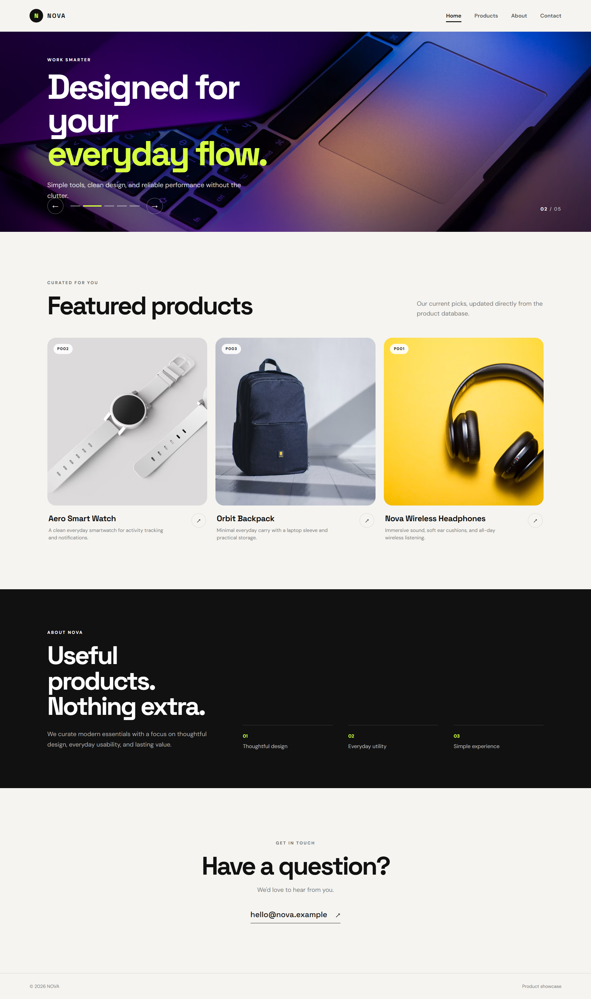

# Product Showcase Website — MongoDB + Express

The task was to develop a responsive product showcase website with an auto-sliding hero banner and MongoDB integration to dynamically manage and display featured products.

A responsive landing page with:
- Navbar with logo and menu links
- 5-slide hero banner
- Featured products loaded dynamically from MongoDB
- `featured: true` products are shown; `featured: false` products are hidden
- Product data can be changed directly in MongoDB; refresh the page to see changes
- REST API with Express + Mongoose

## 1. Install backend

```bash
cd backend
npm install
```

## 2. Configure MongoDB

Copy `.env.example` to `.env` and set your MongoDB connection string.

For local MongoDB:

```env
MONGODB_URI=mongodb://127.0.0.1:27017/product_showcase
PORT=5000
```

For MongoDB Atlas, put your Atlas connection string in `MONGODB_URI`.

## 3. Seed sample products

```bash
npm run seed
```

## 4. Start server

```bash
npm start
```

Then open:

```text
http://localhost:5000
```

The Express server serves the frontend and provides the API.

## Changing featured products

In MongoDB, change for example:

```json
{
  "prod_id": "P003",
  "featured": true
}
```

or set it to `false`.

After refreshing the landing page, the featured-products section will automatically reflect the database value.

## Website Preview

