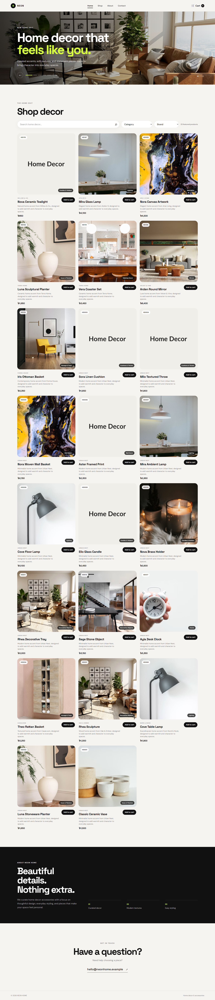

# Product Catalog Search and Filtering System

The task was to make a database-driven product catalog focused on product dataset management, real-time search, brand/category filtering, product image display and shopping cart interactions.

## Core Requirements Implemented

- **Product dataset:** 200 home-decor product records stored in MongoDB.
- **Brand and category metadata:** 10 brands and 10 categories.
- **Product images:** Every product record includes an image URL; category-matched product photography is used where available.
- **Live autocomplete:** Suggestions update as the user types and narrow by the entered prefix.
- **Brand filtering:** Selecting a brand displays products from that brand.
- **Category filtering:** Selecting a category displays matching products across brands.
- **Combined filters:** Search text, brand, and category filters can be used together.
- **Shopping cart:** Add products, view cart contents, change quantities, remove items and see the subtotal.
- **Persistent cart:** Cart contents are saved in browser `localStorage`.
- **Responsive UI:** The existing page layout is retained and adapts to different screen sizes.

## Technology Stack

- **Frontend:** HTML, CSS, JavaScript
- **Backend:** Node.js, Express
- **Database:** MongoDB with Mongoose
- **Configuration:** `dotenv`

## Run Locally

### 1. Requirements

Install Node.js and MongoDB and make sure the MongoDB service is running locally.

### 2. Install backend dependencies

Open a terminal in the `backend/` directory:

```bash
npm install
```

### 3. Seed the database

```bash
npm run seed
```

The seed script clears the existing `product` collection in the configured database and inserts the 200 product records. MongoDB creates the `home_decor_showcase` database automatically if it does not already exist.

> **Note:** Running the seed script again replaces the existing product records in that collection.

### 4. Start the application

```bash
npm start
```

Open [http://localhost:5000](http://localhost:5000) in your browser.

## Database

- **Database:** `home_decor_showcase`
- **Collection:** `product`
- **Records:** 200 products
- **Main fields:** `prod_id`, `name`, `description`, `image`, `brand`, `category`, `price`, `featured`

## Website Preview

